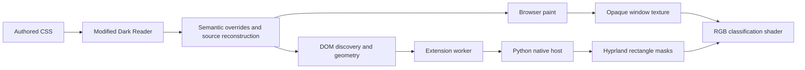
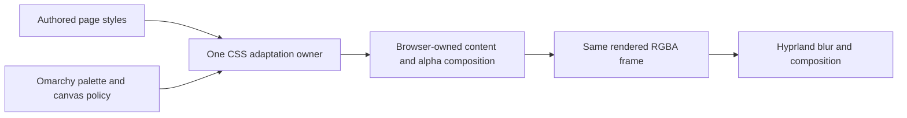

# Architecture review — 2026-10-03

## Decision — Brave extension plus Hyprland plugin

The user has authorized a Brave extension and Hyprland plugin with normal
updates preserved. The Brave source-build experiment is parked and is not part
of the delivery. No browser binary replacement, package version pin or updater
change is being applied. [Plugin research](PLUGIN_RESEARCH.md) records the
existing projects, their media limitations and the remaining capability gate.

Two bounded current-texture probes have now exercised alternatives to geometry
IPC. A spatial carrier failed media collisions and text/scale quality; exact-black
reservation helped opaque interiors but failed partly covered media and text
alpha. Neither rendering candidate is installed. The ABI guard is staged in the
installed plugin binary for its next load, and native/worker source preserves its
actionable rejection reason. No live plugin/browser reload was performed. The
desktop remained locked for this turn's visible interaction check; no finished
all-site rendering result is claimed.

## Source-build experiment — paused

The rectangle-mask design cannot meet the requested general, seamless browser transparency. A browser-owned RGBA surface plus one CSS adaptation engine passed an isolated desktop capability proof. However, that source-build experiment changes Brave itself; it is not merely an extension or Hyprland plugin. The build is **paused** following the user's question about this scope. No compiler is running and the replacement has **not** been installed into the user's browser.

The source and verification below record the parked experiment, not the approved plugin-only delivery. Updating CSS declarations and letting the browser handle normal layout, scrolling and repaint is the page-side design; the unresolved stock-browser boundary is the opaque native backing behind those declarations. Separate DOM geometry and compositor masks cannot supply the missing frame ownership. Resuming the browser build would require explicit agreement to change this boundary.

The defect is at the rendering ownership boundary. Improving rectangle storage can reduce CPU work, but it cannot correlate separately sampled DOM geometry with the browser frame currently being displayed. This capability check should have preceded the mask implementation.

## Current data flow and evidence

Three layers interpret background paint: the bundled CSS engine, the semantic controller and the shader. The controller disables generated sheets to reconstruct authored SVG, label and control paint, reads the resulting cascade, then restores its sheets. This creates repeated restyle work even without an unbounded observer loop. Media/background classification also appears in the controller and the geometry scanner.

The bridge's lifetime checks prevent real errors: stale toggles, wrong-window mapping, address reuse, old native ports and plugin teardown. They are not redundant while the mask design exists. Their timestamps, sequence numbers and root-content leases do not establish a shared browser presentation frame. `MediaMask.cpp` acknowledges the root revision current when a separate rectangle update arrives, which can differ from the frame measured by JavaScript. All ownership checks can succeed while a moving media edge is protected at the wrong position.

On the live finance tab, the 0.2.53 idle measurement recorded 73 geometry callbacks taking 9.247 seconds of a 14.662-second interval: about 127 ms per callback. Copied computed-style scalars did not materially improve that cost. Bounding-box and clipping measurements did not support the earlier assumption that these helpers dominated it. This is evidence to stop speculative cache tuning, not a complete CPU profile or a claim about every site.

## Desktop alpha capability check

Two isolated stock-Brave Wayland runs used a disposable profile, disabled extensions and a static local document. The second also used `--enable-transparent-visuals`. The user browser was not restarted, debug-enabled or reconfigured.

The document had transparent, half-transparent and opaque areas. A successful DevTools default-background override produced renderer PNG alpha values of **0, 128 and 255** at their interiors. A temporary shader on the isolated window's unique class sampled the original GPU texture's alpha into opaque grayscale before the plugin's normal final composition. A green execution marker and black/gray/white calibration strip verified that the shader ran. RGBX sources would have appeared red.

Both desktop results showed the three page interiors at **RGB 246,246,246**, identical to the opaque calibration. The gray calibration was **124,124,124** and black **0,0,0**; native window opacity accounts for the calibration values. No RGBX warning appeared. The logged run used **ABGR8888 (`AB24`)** root buffers, declared a full content opaque region and created **no subsurfaces**. Thus the visible root texture already has alpha one before our custom stage. Clearing only the compositor opaque declaration cannot recover transparency that is absent from these pixels.

This establishes the tested stock-browser path's limitation. The Linux browser widget is already created as translucent, so changing that flag alone is not a justified browser patch. A renderer screenshot is insufficient evidence of native window transparency.

Chromium 153 source provides a concrete embedding boundary: `ContentsWebView` creates a solid-color layer, defaults `background_visible_` to true, and `UpdateBackgroundColor()` sets both that layer and the embedded `RenderWidgetHostView` default to an opaque themed color. Its internal `SetBackgroundVisible(false)` handles both backgrounds, but the renderer's DevTools override does not call it. Split-view and tab-drag underlays, plus the browser's native opaque-region declaration, are adjacent boundaries to verify. These are browser-owned concerns; they cannot be repaired by another page CSS observer.

Pinned source: [content underlay and background setter](https://chromium.googlesource.com/chromium/src/+/153.0.8010.37/chrome/browser/ui/views/frame/contents_web_view.cc#188), [default visibility](https://chromium.googlesource.com/chromium/src/+/153.0.8010.37/chrome/browser/ui/views/frame/contents_web_view.h#87), [existing ChromeOS transparency caller](https://chromium.googlesource.com/chromium/src/+/153.0.8010.37/chrome/browser/ui/ash/wallpaper/wallpaper_controller_client_impl.cc#377), [Linux content opaque-region hints](https://chromium.googlesource.com/chromium/src/+/153.0.8010.37/chrome/browser/ui/views/frame/browser_desktop_window_tree_host_linux.cc#186), [renderer-only DevTools override](https://chromium.googlesource.com/chromium/src/+/153.0.8010.37/third_party/blink/renderer/core/inspector/inspector_emulation_agent.cc#782).

### Passed native-window proof

The exact installed Brave 1.95.101 / Chromium 153.0.8010.37 binary was copied to a private runtime. Guards verified the stock binary SHA-256, symbol build ID and original bytes before modifying only that copy. The user's installed binary and profile were untouched. These guarded binary edits are diagnostic evidence, not the delivery format.

Three independent opaque owners were confirmed:

1. Chromium `ContentsWebView` supplies a solid layer and the embedded renderer's default background.
2. Brave `ContentsBackground` fills the web-content area again with an opaque toolbar color.
3. The Linux browser host advertises an opaque native region.

Clearing the first owner alone produced transparent renderer screenshots but still-opaque desktop pixels. Clearing the native region alone was also insufficient. Clearing both underlays and the native hint made the actual original GPU texture preserve alpha **0, 128 and 255**, including in an F11 static check. With the diagnostic shader removed, the desktop wallpaper appeared through the page while dark image/canvas interiors remained solid. The proof used the normal GPU-enabled Wayland path, not software rendering or disabled browser sandboxing.

The single declaration engine was then exercised on this native-alpha copy. It painted one half-alpha document canvas, cleared nested neutral fills, and retained opaque text, SVG, images and canvas content. A real H.264 video played with intrinsic dimensions 320×180 and `readyState` 4. A nine-second 60 fps desktop recording covered typing, mouse movement, scrolling, native selection and browser zoom. The inspected one-frame-per-second contact sheet showed a stable backdrop and solid media through those sampled interactions. This is not a claim that every recorded frame was quantitatively checked.

The same desktop check caught a native select-popup contrast defect: Blink's popup document supplies its own white body and frame background beneath a transparent select. The source repair targets that owner using the enabled document marker; setting `color-scheme` alone did not fix it. Encoded-video fullscreen, complete native chrome/menu behavior and real-site coverage still require the compiled-source desktop acceptance run.

## Replacement boundary

1. Preserve browser-side alpha through the content underlays and native opaque declaration. The capability proof passed. Source changes are opt-in and retain the original backgrounds for OFF; native Views and Blink popup integration remain part of the source build and desktop acceptance gate.
2. Keep one CSS adaptation engine with declaration, variable, inline-style, adopted-sheet and shadow-root support. Use a narrow semantic policy for canvas paint, media, meaningful action/status colors and control contrast. Apply canvas opacity once; repeated translucent ancestor fills would accumulate toward opacity. Preserve authored SVG/currentColor and distinguish backgrounds from gradients, shadows and other effects.
3. Remove ordinary-page DOM rectangle discovery, per-frame geometry, clipping/occlusion transport, coordinate conversion, native mask queues, acknowledgments and expiry leases. Keep safe global enable/OFF, palette propagation and installer ownership. Do not keep the old mask path as an automatic fallback.
4. Handle browser chrome, native menus, WebUI and video planes at their browser-owned paint boundary. True page alpha alone does not style these surfaces. Opaque canvases/PDFs and normal overlays above media still need explicit product decisions; their pixels cannot be classified from arbitrary CSS alone.

Acceptance requires desktop recordings and media pixel comparisons across light/dark pages, nested scrolling, typing, hover, clicks, menus, tab changes, zoom/output scale, focus and both browser/video fullscreen. Test source ownership and input preservation separately. Passing unit tests cannot substitute for these frame-level checks.

## Replacement implementation

The paused source checkout is `/home/kasey/.local/share/brave-native-source/checkout/src`: Chromium commit `b75a5a95ea1a1b55bdbfd6d9f42d47be7507fb8b` and Brave tag `v1.95.101`, commit `70ef749191a123c073cbd78890f7c9f63e787e49`. Existing Brave upstream patches are retained. The local Component build is configured for the release channel, an isolated toolchain/cache and explicit compiler/Rust concurrency limits. It does not replace system packages or tools.

### One persistent appearance owner

An opt-in bundled component holds `enabled`, palette and focus/fullscreen scales in `chrome.storage.local`. A narrow, component-only browser API mirrors this into one in-memory native state. No second native preference or raw browser-profile database is written. Serialized commits and a session-persisted publication revision prevent old toggle/focus replies from overwriting newer state across worker restarts. The global switch applies automatically to current and future tabs.

The new component has a distinct identity from the legacy unpacked extension. Reusing its ID would make Chromium rewrite the old installed record to component location and silently prevent stock Brave from automatically loading it later. Deliberate retirement through supported browser controls avoids a generic extension-registrar compatibility layer. The opt-in source build also retains stable Brave channel/profile/desktop identity instead of the Component build's normal development suffix.

The native API is restricted by component location, exact extension identity and the opt-in browser switch. Its WebUI stylesheet reader accepts only bounded CSS resources from `chrome://resources` or the exact theme colors endpoint for a live WebUI document. It rejects other resource types, navigation, redirects and document replacement. Ordinary stylesheet reads omit credentials and are size/time bounded.

### One page declaration engine

The adapted CSS engine handles declarations, variables, inline styles, adopted sheets and open/accessible closed shadow roots. Neutral backgrounds and neutral gradient layers become transparent; the top-level document owns the sole canvas. Embedded frames have no extra canvas. Media pixels remain part of the same browser frame, so scrolling does not require another geometry calculation or synchronization bridge. URL/image layers and authored SVG/currentColor remain owned by their original source.

Shown dialogs, popovers and explicitly declared menu/listbox surfaces own an independent translucent canvas with backdrop blur. Clearing these overlays completely leaves underlying page text visible through their labels. Their semantic HTML roles establish ownership without site selectors, element geometry or source-style scans; hiding, authored image layers, status paint and outlines remain intact.

Focus changes mutate only the engine-owned canvas rule. They do not disable/re-enable theme sheets, reconstruct authored source paint or reclassify page elements. OFF restores source styling and the previous document marker. A late shadow-root hook is restored only while still owned by the component.

Neutral-filled borderless controls need an affordance after their fill clears. A zero-specificity quiet outline supplies a default without changing layout; authored outlines and keyboard/selection accents remain authoritative. Tabs, menu items and labeled icon-only buttons receive no new resting boxes. The policy does not sample/reconstruct computed source styles or maintain geometry.

### Native chrome, menus and popup ownership

The browser frame owns one native canvas, clipped around WebContents to avoid stacking alpha over the page canvas. Neutral descendant toolbar/tab/address fills are suppressed while meaningful colored states, foreground, images and quiet boundaries remain. Native menus/bubbles own their own single canvas, and Blink select popups use the marked document's canvas rather than an independent white base. Runtime OFF and no-opt-in launches keep stock rendering. URL Shields/Rewards removal is a separate custom-launch preference, with security/site information and menu access preserved.

Generic WebView hosts clear their renderer default while enabled and restore the explicit native default or existing background-helper role on OFF/detach. A native bubble excludes only visible, actually attached renderer holders from its background paint; title, margins and arrow artwork remain frame-owned. This uses the Views layout already being painted, not a separately sampled page rectangle stream.

Embedded WebUI lacks normal tab/document metadata in runtime messages. A private component API therefore binds its initial identity directly to the current renderer, returns a browser-issued document token and the actual primary Widget state, and rejects stale/inactive/cross-profile contexts. Owned runtime ports publish committed state to these documents and ordinary frames alike. Native shared-CSS reads retain current-primary-WebUI, resource-type, size and navigation checks. Focus updates query the actual owner instead of guessing the last browser tab.

### Omarchy integration

A read-only native messaging host provides the active Omarchy/Ghostty palette and current terminal/desktop opacity multipliers. It transports **no media rectangles** and makes no compositor changes. Atomic theme swaps retain the last valid palette. Current effective canvas alpha is **0.48265 focused**, **0.432 unfocused** and **0.5 fullscreen**. Whole-window Brave opacity must remain one to preserve opaque foreground and media; Hyprland continues to supply blur.

The launcher/runtime snapshot and desktop integration are staged separately. Production installation must use a complete immutable runtime, preserve stock flags/arguments and profile/channel, detect mismatching Brave updates, provide stock fallback and restore only owned files on rollback. The legacy shader must be retired when the native runtime is installed; it must not process the same pixels a second time.

Native New Tab's supported background setting supplies the neutral canvas: backgrounds on, sponsored images off, Solid color black, randomization off. Backgrounds off instead selects an opaque chromatic gradient. Choosing neutral native paint lets the same declaration engine expose Omarchy without a hostname rule or globally stripping media/background images. User links, search and history remain intact.

## Checkpoint and scope

Revision 0.2.54 retains the existing implementation and adds one confirmed safety correction: late shadow-root theme initialization invalidates styles sampled earlier in that geometry snapshot. This prevents publishing a mask from mixed pre/post-initialization styles. It is not the architectural flicker fix.

The production browser remains on 0.2.54. Its existing geometry bridge and shader have not been replaced, and its process has not been restarted or debug-enabled. Temporary diagnostics apply only to uniquely identified private windows. Task-owned profiles, symbols, servers and captures are removed after their evidence is recorded and acceptance is complete; maintenance regression sources, source patches and build outputs remain.
